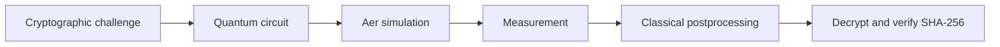

# Ten Locks, One Message

*Quantum Algorithms for Cryptography, Hidden Structure, and Secure Communication*

[](requirements.txt) [](requirements.txt) [](requirements.txt)

Ten cryptographic challenges connect quantum circuits with classical cryptanalysis and secure communication. The team's solutions execute circuits on Qiskit Aer, interpret measurements with classical postprocessing, and verify recovered plaintexts against SHA-256 hashes. The accompanying mathematical models explain the interference, hidden structure, and number theory behind those steps.

**Verified candidate:** [`integration/optimized-v4-candidate@73f4dbe`](https://github.com/qsc032376-hash/quantum-cryptography-ten-locks/tree/73f4dbe330de3098acb368464d3f5606c30259f8). Its complete renamed-directory official Checker run recorded 10/10 `full`, matching SHA-256, valid metrics and no flags. This is local verification, not a final competition judgment or ranking. The mathematical branch contains documentation, not the v4 submission.

## Contents

- [Project highlights](#project-highlights)
- [The ten quantum locks](#the-ten-quantum-locks)
- [How it works](#how-it-works)
- [Mathematical foundations](#mathematical-foundations)
- [Quantum circuit complexity](#quantum-circuit-complexity)
- [Repository architecture](#repository-architecture)
- [Installation and usage](#installation-and-usage)
- [Verification and reproducibility](#verification-and-reproducibility)
- [Circuit optimization](#circuit-optimization)
- [Interactive web demo](#interactive-web-demo)
- [Team](#team)
- [Acknowledgments](#acknowledgments)
- [Security and submission](#security-and-submission)

## Project highlights

- Ten `full` results in the verified v4 full-package Checker run, backed by recorded SHA-256 evidence.
- Quantum circuits executed on Aer using Bernstein–Vazirani, BB84, Deutsch–Jozsa, Simon, Grover search, quantum phase estimation (QPE), and Shor techniques.
- Reproducible resource measurements under the official scoring configuration, with mathematical modeling and correctness analysis for each tier.
- Modular quantum and classical components in the verified v4 candidate, with measurements driving classical recovery and verification.

## The ten quantum locks

`FULL` below denotes the local full-package official Checker result for v4 at `73f4dbe`; it is not a judge's final award. Each theory link describes the corresponding mathematical model.

| Tier | Algorithm | Mathematical objective | Verification |
| --- | --- | --- | --- |
| [1](docs/TIER01_THEORY.md) | Bernstein–Vazirani | Recover a hidden parity string. | FULL |
| [2](docs/TIER02_THEORY.md) | BB84 | Identify the disturbed link and reconcile a key from the clean link. | FULL |
| [3](docs/TIER03_THEORY.md) | Deutsch–Jozsa | Classify 24 promised constant or balanced functions. | FULL |
| [4](docs/TIER04_THEORY.md) | Simon | Recover a hidden XOR period from linear equations over $\mathbb F_2$. | FULL |
| [5](docs/TIER05_THEORY.md) | Grover | Search a reversible toy-cipher oracle for a 10-bit key. | FULL |
| [6](docs/TIER06_THEORY.md) | Grover | Search a 14-bit key space with multiple candidates and a classical checksum. | FULL |
| [7](docs/TIER07_THEORY.md) | QPE | Estimate a phase encoding a 14-bit integer. | FULL |
| [8](docs/TIER08_THEORY.md) | Shor order finding | Factor an RSA modulus and unwrap its key. | FULL |
| [9](docs/TIER09_THEORY.md) | Shor order finding | Factor a second RSA modulus using modular arithmetic and phase measurements. | FULL |
| [10](docs/TIER10_THEORY.md) | Shor discrete logarithm | Recover a Diffie–Hellman exponent from measured group relations. | FULL |

## How it works



The circuit prepares and transforms quantum states in an ideal simulator; measurements yield classical samples. Classical code then interprets those samples, reconstructs a candidate key or mathematical relation, decrypts the challenge data, and checks the result. A hash match verifies the recovered plaintext, while the circuit and measurement analysis explain the recovery method.

## Mathematical foundations

- **Hidden strings and interference.** Bernstein–Vazirani encodes $f_s(x)=s\cdot x\pmod 2$ as a phase; Hadamard interference reveals $s$. Deutsch–Jozsa uses the same phase-kickback principle to distinguish promised functions. Simon samples equations $y\cdot s=0\pmod 2$, solved classically over $\mathbb F_2$.
- **Amplitude amplification.** For a marked fraction $M/N$, let $\sin^2\theta=M/N$. After $r$ ideal Grover iterations, the marked-state probability is $\sin^2((2r+1)\theta)$. The reversible oracle defines what is marked; classical checks distinguish candidates where needed.
- **Phase estimation.** If $U|u\rangle=e^{2\pi i\phi}|u\rangle$, controlled powers of $U$ and an inverse quantum Fourier transform concentrate measurement probability near a binary approximation of $\phi$.
- **Order and factorization.** Phase samples yield candidate denominators for the order $r$ of $a\bmod N$. When $r$ is even and the usual nontriviality conditions hold, $\gcd(a^{r/2}\pm1,N)$ can reveal factors; continued fractions and validation are classical.
- **Discrete logarithms.** For $A=g^a$ in a group of order $r$, the function $f(x,z)=g^xA^z$ has hidden relations $\Delta x+a\Delta z\equiv0\pmod r$. Fourier sampling supplies information from which classical postprocessing recovers and checks a candidate exponent.

The linked tier documents give derivations, assumptions, and circuit details. BB84 instead uses basis matching and observed error rates to assess the channel.

## Quantum circuit complexity

The figures below are the recorded official Checker metrics for the verified v4 candidate. The Checker scores the circuit executed in `solve()` with the most transpiled two-qubit gates, breaking ties by depth; Tier 2 uses the Channel measurement log. The scoring configuration uses `rz`, `sx`, `x`, and `cx`, optimization level 1, and transpiler seed 12345. Measurements, resets, and barriers are excluded from gate counts. These simulator/transpiler metrics do **not** demonstrate practical quantum advantage; shots, repeated executions, and classical preparation are additional costs.

| Tier | Active qubits | Two-qubit gates | Circuit depth | Total gates |
| --- | ---: | ---: | ---: | ---: |
| 1 | 25 | 151 | 44 | 298 |
| 2 | 1 | 0 | 3 | 3 |
| 3 | 7 | 7,808 | 8,771 | 19,497 |
| 4 | 20 | 183 | 195 | 455 |
| 5 | 19 | 15,150 | 29,503 | 42,211 |
| 6 | 22 | 3,000 | 5,883 | 9,534 |
| 7 | 15 | 230 | 271 | 763 |
| 8 | 18 | 49,920 | 135,160 | 148,085 |
| 9 | 21 | 89,075 | 235,048 | 263,601 |
| 10 | 19 | 82,804 | 218,263 | 245,153 |

The ten separately scored circuits sum to **248,321 two-qubit gates** and **633,141 per-tier depth**; this is not the depth of one combined circuit. The historical v1 figures are 307,349 and 787,876, respectively; those recorded runs used a different environment, so the comparison is not a controlled timing experiment. See the [v4 integration report](https://github.com/qsc032376-hash/quantum-cryptography-ten-locks/blob/73f4dbe330de3098acb368464d3f5606c30259f8/docs/OPTIMIZED_V4_CANDIDATE.md), its [Checker evidence](https://github.com/qsc032376-hash/quantum-cryptography-ten-locks/blob/73f4dbe330de3098acb368464d3f5606c30259f8/docs/evidence/v4/report.json), and the [final analysis](docs/FINAL_QUANTUM_ANALYSIS.md).

## Repository architecture

- [`docs/`](docs/) — theory for all ten tiers and the mathematical optimization plan on this branch.
- [`tier01/`–`tier10/`](tier01/) — official challenge materials, helpers, and starter notebooks for each tier.
- [`common/`](common/) — shared cryptographic and verification helpers.
- [`submissions/TEAM_TEMPLATE/`](submissions/TEAM_TEMPLATE/) — official submission layout; the verified v4 candidate additionally contains `submissions/team3/`, with the team's circuits and classical modules.
- [`tools/`](tools/) — official setup and submission checkers and scoring configuration.
- [`references/`](references/) — documentation and research references. The v4 candidate also contains `tests/` and integration reports. There is no `benchmarks/` or `web/` directory on this branch.

**Branch distinction:** `feature/mathematical-modeling` contains analysis and prototype work but does not contain the v4 team submission or tests. The v4 candidate is a separate history; use a separate checkout for the commands below that refer to those files.

## Installation and usage

Python 3.12 is the project's tested version. From a repository checkout, create an environment and install the exact versions in [`requirements.txt`](requirements.txt) (including Qiskit 2.6.1 and Aer 0.18.2):

```bash
python3.12 -m venv .venv
source .venv/bin/activate          # Windows: .venv\Scripts\activate
python -m pip install -r requirements.txt
python tools/check_setup.py
```

To reproduce v4 without changing this branch or a verified branch, fetch the candidate and create a detached worktree from the repository root:

```bash
git fetch origin integration/optimized-v4-candidate
git worktree add --detach ../ten-locks-v4 73f4dbe330de3098acb368464d3f5606c30259f8
cd ../ten-locks-v4
python3.12 -m venv .venv
source .venv/bin/activate
python -m pip install -r requirements.txt
python -B tests/test_tier08_tier09_integration.py -v
python -B tests/test_tier10_integration.py -v
python -B tools/check_submission.py submissions/team3 --out /tmp/ten-locks-check
```

The tests above are v4 integration tests; they are not a substitute for the complete official check. The last command executes the official Checker across the team folder and can take substantial simulation time; keep its output private. For circuit metrics only, use `python tools/check_submission.py submissions/team3 --metrics-only` in the v4 checkout. Metrics-only skips the hash check and is not a substitute for full verification. The command examples follow the repository and v4 integration report; they were not rerun for this documentation-only change.

For a new submission, copy `submissions/TEAM_TEMPLATE/` to `submissions/<team_name>/`, implement each tier's `solve()` and `build_circuit()`, and retain the template's repository-root imports. See [the challenge](CHALLENGE.md), [helper interfaces](HELPERS.md), and [scoring rules](SCORING.md). Start with a tier's README and notebook, run its circuit on Aer, interpret measurements, and transfer the solution into the team folder.

## Verification and reproducibility

The v4 report records a single full-package `full` and matching SHA-256 for every tier after a renamed-directory import check. Earlier v1 evidence and v4 evidence are separate. The Checker independently hashes returned plaintext and records Aer execution; a matching hash alone does not establish the validity of the recovery method.

Finite-shot sampling can fail or produce insufficient evidence, and a successful fixed-seed run does not guarantee success across seeds. The scoring transpiler seed is fixed at 12345; simulator and sampling seeds depend on the relevant implementation and challenge data. Reproduction requires the pinned dependencies, scoring configuration, candidate revision, and appropriate execution settings. Aer models simulation, not the noise and constraints of actual hardware.

## Circuit optimization

v4 integrates Tier 5 public-constant folding, Tier 9 exact shared-predicate fanout, and Tier 10 ancilla-free fanout plus inverse-QFT wire relabeling. The [final mathematical analysis](docs/FINAL_QUANTUM_ANALYSIS.md) distinguishes proofs, synthetic tests and Checker evidence; the [presentation script and judge Q&A](docs/FINAL_PRESENTATION_SCRIPT.md) summarize the result. The [optimization plan](docs/MATHEMATICAL_OPTIMIZATION_PLAN.md) is historical research, not proof that every proposal was implemented. Tier 8 is unchanged in v4; prospective v5 work is not claimed as integrated.

## Interactive web demo

**Under development:** Guided Introduction → Ten Locks Dashboard → Circuit Visualization → Measurement Analysis → Verification. No web demo is implemented in this branch.

## Team

| Member | Contribution |
| --- | --- |
| Sicheng Qian | Mathematical Modeling & Optimization; Team Coordination |
| Junqi Sheng | Quantum Circuit Design & Qiskit Implementation |
| Youyang Shang | Classical Cryptography & Software Development |
| Junrui Yu | Integration, Verification & Performance Benchmarking |

## Acknowledgments

We thank the Qiskit Fall Fest Ohio organizers and The Quantum Club at Ohio State for the challenge, and acknowledge [IBM Qiskit](https://docs.quantum.ibm.com/) and [Qiskit Aer](https://qiskit.github.io/qiskit-aer/) for the software used in this work. Additional sources are listed in [references](references/README.md).

## Security and submission

This is a private competition workspace. Keep challenge materials, hidden keys, recovered secrets, and decrypted messages private; do not publish solutions or open a public pull request. Do not modify official hashes or tools. The official rules require a circuit executed in `solve()` for full tier credit and allow classical postprocessing.

Submit a zip containing only `submissions/<team_name>/`, including tier solutions, a linked `WRITEUP.md`, and presentation material as appropriate; exclude environments and caches. The organizers check the team folder in a fresh copy of the challenge. Upload through the [official submission form](https://docs.google.com/forms/d/e/1FAIpQLSeYZrd6v9SxdsHyUpgYfwjhpEHVlhk7JjN5nYaVMcpo3uj7FQ/viewform) by **November 13, 2026, 12:00 PM Eastern**. Resubmission replaces the previous submission and resets its tiebreaker time. Consult [CHALLENGE.md](CHALLENGE.md) and [SCORING.md](SCORING.md) for the complete rules and presentation requirements.
